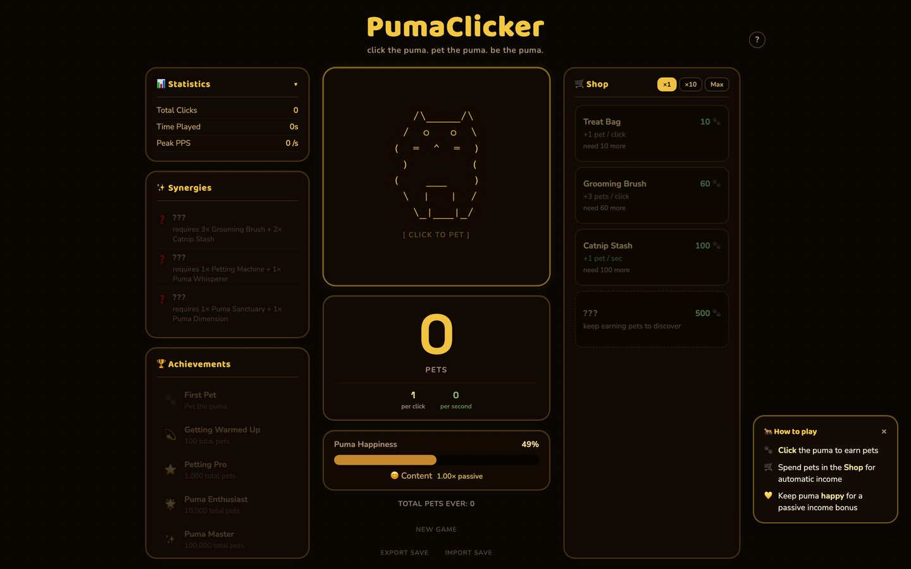
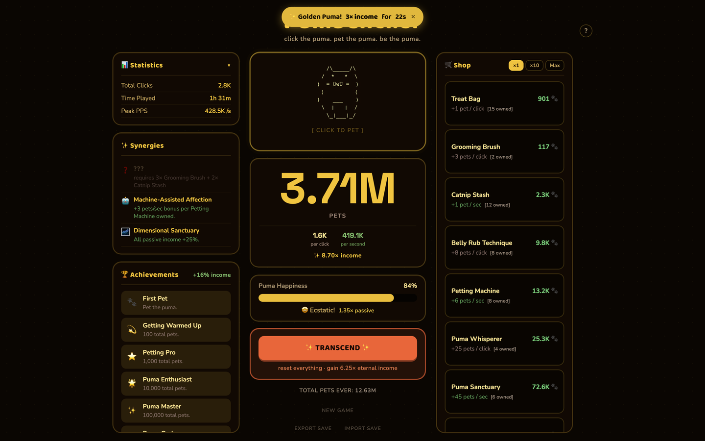
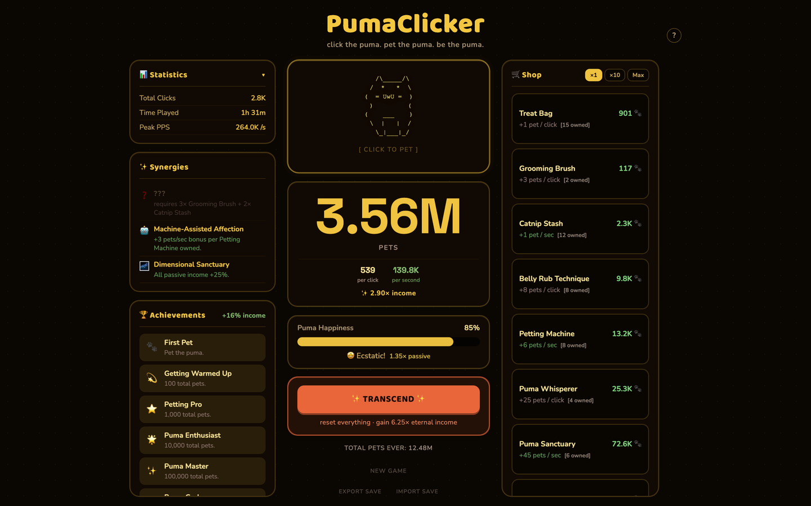

# PumaClicker

**Click the puma. Earn pets. Build an empire of affection.** A browser-based idle clicker game, with an ASCII-art puma whose mood shows on its face.

**Play:** [greykit.com/games/pumaclicker](https://greykit.com/games/pumaclicker/)

## How it plays

**Click** the puma to earn pets, and **spend** them in the Shop on 14 upgrades, from a Treat Bag to Puma God Mode, that boost click power and passive income. The puma keeps earning while you're not clicking, and while the tab is closed (up to 4 hours). Its happiness drifts toward 50% and scales passive income from 0.5x to 1.5x; gentle petting raises it, over-petting drains it. The right combinations of upgrades unlock synergy bonuses.

Every few minutes a golden puma appears: catch it within 12 seconds for **3x income** for 30 seconds. Once lifetime pets reach the threshold (1M, ×8 per ascension), Transcending resets pets, upgrades and happiness for a permanent **2.5x income multiplier** that stacks with each ascension. 24 achievements each add a permanent +1% income.

## Keys

Click or tap the puma, or `Enter` / `Space` with it focused. `?` opens About. In the browser console, `puma.help()` lists the cheat commands.

## Saves

The game is saved in the browser's `localStorage` under `pc-save-v1`, with onboarding state in other `pc-` keys beside it. Save export and import move progress between browsers as a save code, and **New Game** (two clicks) wipes the save.

## Credits

By Matthew "Shan" Romanek, with Claude. Built by [greykit.com](https://greykit.com/).

Made for my own play. Nothing here is offered: no support, no updates, no licence.
